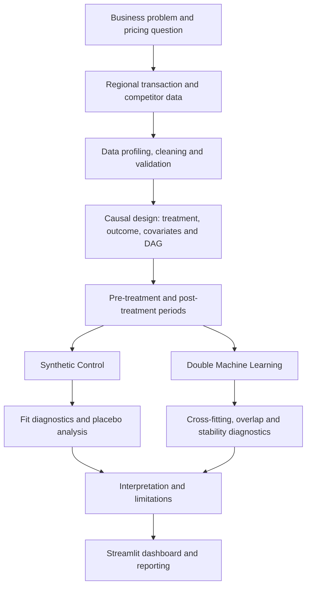
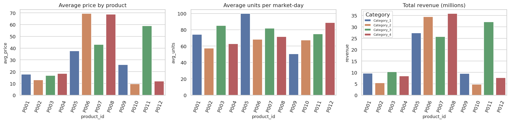
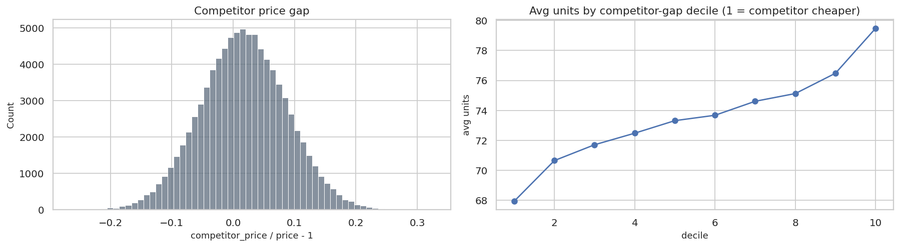
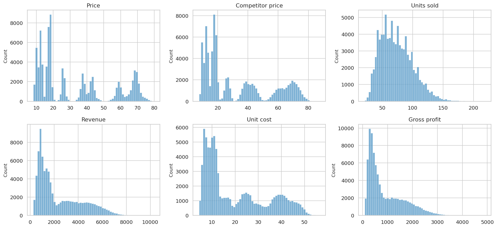
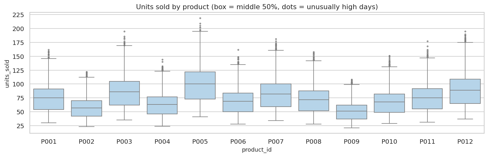
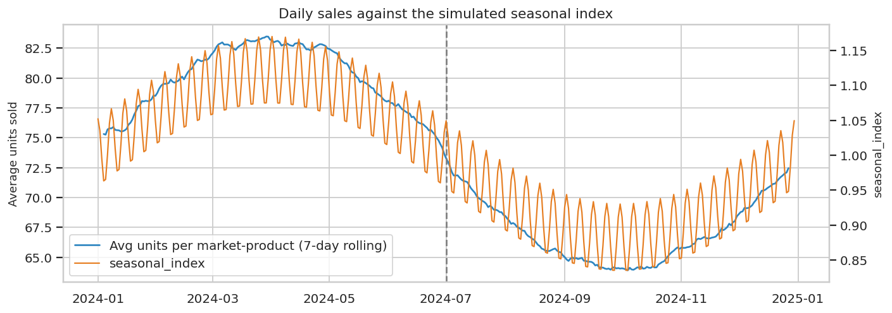

# Causal Inference & Synthetic Control Engine for Algorithmic Pricing

<p align="center">
  <strong>Zaalima Development | Data Analytics Internship</strong><br>
  <em>Counterfactual analysis of dynamic pricing interventions using Synthetic Control and Double Machine Learning</em>
</p>

<p align="center">
  
  
  
  
  
</p>

> [!IMPORTANT]
> **Evidence and interpretation notice:** The dataset supplied with the reviewed repository is simulated development data. The saved DML estimates are explicitly marked `EXPLORATORY_NOT_VALIDATED`. They must not be described as proven causal effects or real commercial impact. The README distinguishes implemented functionality, exploratory outputs, official project requirements, and work that still needs validation.

---

## Table of Contents

1. [Executive Summary](#1-executive-summary)
2. [Business Problem](#2-business-problem)
3. [Project Objectives](#3-project-objectives)
4. [Business Questions](#4-business-questions)
5. [Project Scope and Official Milestones](#5-project-scope-and-official-milestones)
6. [Dataset Description](#6-dataset-description)
7. [End-to-End Workflow](#7-end-to-end-workflow)
8. [Causal Design Concepts](#8-causal-design-concepts)
9. [Methodology](#9-methodology)
10. [Streamlit Dashboard](#10-streamlit-dashboard)
11. [Dashboard and Analysis Visualizations](#11-dashboard-and-analysis-visualizations)
12. [Repository Structure](#12-repository-structure)
13. [Technology Stack](#13-technology-stack)
14. [Installation and Setup](#14-installation-and-setup)
15. [Running the Application](#15-running-the-application)
16. [Running the Analysis and Tests](#16-running-the-analysis-and-tests)
17. [Current Outputs and Findings](#17-current-outputs-and-findings)
18. [Validation Strategy](#18-validation-strategy)
19. [Limitations and Risks](#19-limitations-and-risks)
20. [Team Responsibilities](#20-team-responsibilities)
21. [Reproducibility and Git Workflow](#21-reproducibility-and-git-workflow)
22. [Future Enhancements](#22-future-enhancements)
23. [Glossary](#23-glossary)
24. [Disclaimer](#24-disclaimer)

---

## 1. Executive Summary

This project is an analytical prototype designed to study the impact of a dynamic pricing intervention on business outcomes such as revenue, gross profit, and units sold.

A simple before-and-after comparison cannot establish whether a price change caused a change in business performance. Other factors—including seasonality, promotions, competitor prices, market characteristics, and time effects—may influence the observed outcome.

The project explores two complementary causal-inference approaches:

- **Synthetic Control Method (SCM):** constructs a weighted combination of untreated donor markets to approximate the pre-intervention behaviour of a treated market.
- **Double Machine Learning (DML):** uses machine-learning nuisance models and cross-fitting to estimate treatment effects while adjusting for observed covariates, subject to the validity of the causal design and assumptions.

A Streamlit application brings together descriptive analysis, market and product comparisons, pricing and promotion analysis, saved SCM diagnostics, saved exploratory DML outputs, and data-quality views.

### Project at a glance

| Item | Description |
|---|---|
| Project | Causal Inference & Synthetic Control Engine for Algorithmic Pricing |
| Internship | Zaalima Development – Data Analytics |
| Main business theme | Measuring the impact of dynamic pricing |
| Causal methods | Synthetic Control and Double Machine Learning |
| Dashboard | Streamlit |
| Data type in reviewed package | Simulated development data |
| Current evidence status | Analytical prototype; exploratory estimates require further validation |

---

## 2. Business Problem

Pricing teams often evaluate a price change by comparing business performance before and after the intervention.

For example, revenue may increase after a price increase. However, this does not automatically mean that the price increase caused the revenue increase.

The observed change may also be influenced by:

- Seasonal demand patterns.
- Promotional campaigns.
- Competitor pricing changes.
- Differences between markets.
- Product-level demand variation.
- Other time-varying business conditions.

The central challenge is to estimate a **counterfactual**: what might have happened to the treated market if the pricing intervention had not occurred?

The project uses causal-inference methods to construct and analyse this counterfactual under explicit assumptions.

### Why ordinary comparison may be insufficient

A before-and-after comparison can mix the effect of the intervention with unrelated changes over time. A comparison between treated and untreated markets can also be misleading if the markets differ before treatment or if untreated markets are indirectly affected by the intervention.

SCM and DML provide structured approaches to this problem, but neither method automatically guarantees causal identification. Their assumptions, data quality, treatment assignment, and validation must be examined.

---

## 3. Project Objectives

The project aims to:

1. Prepare and inspect regional market transaction and competitor-pricing data.
2. Define the treatment, outcome, pre-treatment period, post-treatment period, and relevant covariates.
3. Represent assumed causal relationships and potential confounders through a Directed Acyclic Graph (DAG).
4. Construct a synthetic comparison using a donor pool of untreated markets.
5. Assess Synthetic Control pre-treatment fit using Mean Squared Prediction Error (MSPE).
6. Develop a reusable DML-style pipeline with preprocessing and cross-fitting.
7. Estimate treatment effects and document the assumptions and limitations.
8. Examine overlap, missingness, leakage risks, and estimate stability.
9. Present descriptive analysis and available model diagnostics in Streamlit.
10. Translate supported analytical findings into cautious business interpretation.

---

## 4. Business Questions

The analysis is organised around the following questions:

1. How did revenue, gross profit, and units sold behave across markets and products?
2. How did treated markets behave before and after the pricing intervention?
3. How closely can a weighted combination of donor markets reproduce a treated market before intervention?
4. What is the post-intervention gap between actual and synthetic outcomes?
5. What treatment-effect estimates does the current DML pipeline produce on the supplied development data?
6. Are the treatment and comparison observations sufficiently comparable for the selected estimation strategy?
7. How sensitive are the findings to causal assumptions, donor selection, and modelling choices?
8. Which findings are descriptive, which are exploratory model outputs, and which—if any—are sufficiently validated for business interpretation?

---

## 5. Project Scope and Official Milestones

The official project document describes the following four-week sequence.

| Period | Official project focus | Expected outputs |
|---|---|---|
| Week 1 | Ingest regional transactions and competitor pricing; construct DAGs; separate pre-treatment and treatment periods | Data inputs, causal design, period definitions |
| Week 2 | Build Synthetic Control; apply DML; calculate pre-treatment MSPE | Initial SCM and DML estimators, fit diagnostics |
| Week 3 | Quantify ATE and CATE; conduct sensitivity analysis; run cross-validation | Treatment-effect analysis, robustness and reliability checks |
| Week 4 | Develop an interactive what-if application; compare actual and synthetic trajectories; prepare executive causal report | Dashboard, diagnostics, actionable report |

### Scope-status distinction

The official plan describes intended project deliverables. The reviewed repository package demonstrates some of these components, but not every intended deliverable is verified as complete.

In particular:

- The app contains descriptive filters and saved SCM/DML diagnostic views.
- The inspected app does not establish that changing a what-if price input reruns the causal model and recalculates a counterfactual.
- The saved DML point-estimate table does not by itself establish validated CATE analysis.
- Exploratory estimates and diagnostic charts do not by themselves establish validated causal impact.
- A public hosted dashboard URL was not present in the reviewed repository package.

Update this section only when new code, test evidence, mentor approval, or deployment evidence supports a status change.

---

## 6. Dataset Description

The reviewed development dataset is a simulated market-product-date panel.

### Dataset profile

| Attribute | Documented value |
|---|---:|
| Number of observations | 87,600 |
| Number of markets | 20 |
| Number of products | 12 |
| Start date | 2024-01-01 |
| End date in supplied data | 2024-12-30 |
| Treated markets | M001, M002, M003, M004 |
| Intervention date | 2024-07-01 |
| Simulated price intervention | 8% increase in treated markets |

**Date note:** 2024 is a leap year. The supplied data range ends on December 30, so December 31 is not included in the documented date range.

**Measurement note:** Currency and measurement units are not specified in the supplied dataset. Do not label values as rupees, dollars, or any other currency unless the data owner confirms the unit.

### Important fields

| Column | Meaning | Analytical role |
|---|---|---|
| `market_id` | Market identifier | Panel/group identifier |
| `region` | Region associated with the market | Market descriptor |
| `product_id` | Product identifier | Product/panel dimension |
| `category` | Product category | Product descriptor |
| `date` | Observation date | Time index |
| `treated_market` | Indicates designated treated markets | Treatment-group indicator |
| `treatment_date` | Configured intervention date | Intervention metadata |
| `treatment` | Indicates treated observations in the treatment period | Treatment indicator |
| `price` | Selling price | Pricing feature / intervention-related variable |
| `competitor_price` | Competitor price | Potential covariate, subject to causal timing |
| `promotion` | Promotion feature | Potential covariate, subject to causal timing |
| `day_of_week` | Day-of-week information | Time-related feature |
| `seasonal_index` | Seasonal feature | Time-related feature |
| `units_sold` | Units sold | Business outcome |
| `revenue` | Revenue | Business outcome |
| `unit_cost` | Unit cost | Cost feature |
| `gross_profit` | Gross profit | Business outcome |

### Treatment structure

The development scenario designates four markets (M001–M004) as treated and uses July 1, 2024 as the intervention date. The scenario describes an 8% price increase for treated markets.

This is a simulated treatment setup. The treatment assignment mechanism, timing, covariates, possible spillovers, and causal assumptions must be reviewed before interpreting estimates causally.

### Data-quality observations

The reviewed cleaned file contains missing values in some columns:

- `treatment_date`: missing for many untreated observations, which may be expected depending on the encoding.
- `competitor_price`: a small number of missing values.
- `promotion`: a small number of missing values.

Missingness should be interpreted using the data dictionary and the role of each field. Do not automatically fill or remove values without documenting the chosen rule.

---

## 7. End-to-End Workflow



### Workflow stages

**Stage 1 – Business understanding**

Define the pricing intervention, target business outcome, unit of analysis, comparison group, and decision the analysis should support.

**Stage 2 – Data preparation**

Inspect the schema, data types, missingness, duplicates, date coverage, treatment coding, and outcome calculations.

**Stage 3 – Causal design**

Specify the treatment, outcome, confounders, pre-treatment period, post-treatment period, and assumptions. A DAG represents the assumed relationships; it is not proof of causality.

**Stage 4 – Exploratory data analysis**

Study market and product trends, price distributions, competitor price gaps, promotion patterns, seasonality, and demand.

**Stage 5 – Synthetic Control**

Select eligible donor markets, estimate weights, construct the synthetic outcome, and assess pre-treatment fit.

**Stage 6 – Double Machine Learning**

Prepare covariates, train nuisance models using a suitable fold strategy, perform cross-fitting, and estimate exploratory treatment effects.

**Stage 7 – Validation**

Review overlap, missing-data handling, leakage, sample size, stability, model outputs, and causal assumptions.

**Stage 8 – Dashboard and communication**

Present descriptive views and saved diagnostic outputs with appropriate labels, units, warnings, and limitations.

---

## 8. Causal Design Concepts

### Treatment

The intervention being evaluated. In this development scenario, treatment is associated with the configured price increase in designated markets after July 1, 2024.

### Outcome

The business measure whose response is being studied. The current analysis includes revenue, gross profit, and units sold.

### Treatment group

Markets designated to receive the pricing intervention.

### Control / donor pool

Markets not designated as treated and considered as potential comparisons. Donor eligibility must be checked for comparable pre-treatment behaviour and potential spillover exposure.

### Pre-treatment period

Observations before the intervention. These observations are used to understand baseline behaviour and, for SCM, fit the synthetic comparison.

### Post-treatment period

Observations after the intervention date. These observations are used to examine the difference between treated and counterfactual outcomes.

### Confounder

A variable that influences both treatment assignment and the outcome, potentially creating a misleading association if not handled appropriately.

### DAG – Directed Acyclic Graph

A DAG represents hypothesised causal relationships among treatment, outcome, and other variables. It helps communicate assumptions and identify potential adjustment variables.

A DAG is a design tool—not empirical proof that the assumed relationships are true.

### Counterfactual

The outcome that would have been observed for a treated unit under the alternative condition—in this case, if the pricing intervention had not occurred.

---

## 9. Methodology

### 9.1 Exploratory Data Analysis

EDA is used to understand the data before causal estimation.

The repository's figures cover topics such as:

- Monthly totals.
- Treated versus control trends.
- Market comparison.
- Product comparison.
- Price versus units sold.
- Competitor price gaps.
- Promotion analysis.
- Distributions and boxplots.
- Seasonality-related patterns.

EDA findings are descriptive. A pattern or correlation in these charts should not be presented as a causal effect.

### 9.2 Synthetic Control Method

Synthetic Control constructs a comparison unit as a weighted combination of untreated donor units.

Conceptually:

```text
Synthetic outcome at time t
    = weight 1 × donor market 1 outcome at time t
    + weight 2 × donor market 2 outcome at time t
    + ...
    + weight J × donor market J outcome at time t
```

The weights are chosen to reproduce the treated unit's pre-intervention behaviour as closely as the selected method allows.

#### Main steps

1. Define treated markets and candidate donor markets.
2. Align outcome observations over the same time periods.
3. Inspect donor-market eligibility and potential spillovers.
4. Estimate donor weights using the implemented optimization procedure.
5. Construct the synthetic outcome trajectory.
6. Compare actual and synthetic outcomes before and after intervention.
7. Calculate pre-treatment fit diagnostics such as MSPE.
8. Inspect placebo and robustness outputs where supported.

#### MSPE

Mean Squared Prediction Error measures the average squared difference between actual and synthetic outcomes over a selected period.

Pre-treatment MSPE helps assess how closely the synthetic series reproduces the treated market before intervention.

A poor pre-treatment fit should be investigated and disclosed. An MSPE ratio is a diagnostic—not a p-value and not proof of causal impact.

#### Current implementation note

The reviewed SCM runner generates market series internally rather than clearly loading the canonical cleaned transaction dataset. Verify data lineage and ensure the SCM output is based on the intended, documented input before presenting the result as integrated evidence.

### 9.3 Double Machine Learning

Double Machine Learning uses machine-learning models to estimate nuisance relationships and then combines their predictions to estimate a treatment effect.

The reviewed pipeline includes:

- Input and schema validation.
- Numeric and categorical preprocessing.
- Median imputation and scaling for numeric features.
- Most-frequent imputation and ordinal encoding for categorical features.
- Ridge regression as an outcome nuisance model.
- Logistic Regression as a treatment nuisance model.
- Date-block cross-fitting using `GroupKFold`.
- Partialling-out treatment-effect estimation.
- Propensity overlap screening and diagnostic outputs.

#### Conceptual steps

1. Define treatment variable `T`, outcome `Y`, and covariates `X`.
2. Split observations into folds using the selected grouping strategy.
3. Fit nuisance models on training folds.
4. Generate predictions for held-out observations.
5. Construct residualised treatment and outcome quantities.
6. Estimate the treatment effect using the residualised quantities.
7. Review diagnostics, assumptions, and uncertainty estimation.

#### Cross-fitting

Cross-fitting reduces the risk of evaluating nuisance predictions on the same observations used to fit those nuisance models.

The fold strategy must respect the structure of the data. With repeated observations across markets, products, and time, random row-level splitting can produce leakage or overly optimistic evaluation if related observations appear across train and validation partitions.

#### ATE

Average Treatment Effect describes the average treatment effect over the target population under the selected estimand and assumptions.

#### CATE

Conditional Average Treatment Effect describes how the treatment effect varies across defined covariate profiles or subgroups.

**Implementation status note:** The official project plan includes ATE and CATE. The saved exploratory DML artifact reviewed for this README contains point estimates by outcome; this does not establish that a validated CATE analysis has been completed.

#### Uncertainty estimation

The reviewed saved output uses an IID-only standard-error approach. Repeated market/product/time observations may be dependent, so IID-only uncertainty should not be presented as final panel-robust inference. A suitable inference strategy must be selected and justified for the data structure.

### 9.4 Keep SCM and DML estimates distinct

SCM and DML may target different estimands and rely on different assumptions. Compare their results carefully, but do not average them automatically.

Any combined estimate would require a defensible methodological explanation and compatible estimands.

---

## 10. Streamlit Dashboard

The application entry point is:

```text
app/streamlit_app.py
```

The dashboard is titled **Causal Pricing Intelligence Studio** and contains six main tabs.

### 10.1 Overview

Purpose: provide a high-level view of the selected data.

The reviewed app includes KPI cards for:

- Revenue.
- Gross profit.
- Units sold.
- Average selling price.
- Observation count.

It also includes trend and comparison charts such as treated-versus-untreated trends, outcome comparisons, and price-versus-units views.

### 10.2 Market & Product

Purpose: compare performance across markets and products.

Reviewed components include:

- Market revenue comparison.
- Product/category treemap.
- Searchable and sortable market summary table.
- CSV export.

### 10.3 Pricing & Promotions

Purpose: inspect price positioning and promotion-related patterns.

Reviewed components include:

- Selling price minus competitor price distribution.
- Promotion comparison.
- Selling-price boxplot.

### 10.4 Synthetic Control

Purpose: display saved SCM diagnostics.

Reviewed components include:

- MSPE diagnostics and ratio chart.
- Actual-versus-synthetic gross-profit trend.
- Actual-versus-synthetic units-sold trend.
- Donor weights and download option.

### 10.5 DML Diagnostics

Purpose: display available DML outputs and diagnostic warnings.

Reviewed components include:

- Saved exploratory DML estimate table.
- Estimate comparison chart.
- Diagnostic warning panels.

The displayed estimates should remain labelled exploratory until the causal design, inference, and robustness checks are validated.

### 10.6 Data Quality

Purpose: help inspect data completeness and selected records.

Reviewed components include:

- Missingness profile.
- Validation checks.
- Filtered record explorer (limited to a maximum of 1,000 displayed records).
- CSV download options.

### Dashboard filter behaviour

The sidebar includes filters for:

- Date range.
- Markets.
- Products.
- Categories.
- Metric.
- Daily, weekly, or monthly granularity.
- Reset filters.

The descriptive data views respond to these filters. The saved SCM and DML outputs are precomputed artifacts; changing the dashboard filters does not refit those estimators.

### What the current dashboard should not be assumed to do

The inspected code does not establish a fully dynamic what-if pricing simulator that accepts a new price scenario, reruns the causal model, and recalculates the counterfactual. This is an official Week 4 objective and should be treated as a remaining scope item unless a later implementation and test demonstrate it.

---

## 11. Dashboard and Analysis Visualizations

The following images are graph assets included with this README. They are genuine project analysis figures, not screenshots of a live hosted Streamlit session.

> Keep the `assets/` directory next to this README when uploading to GitHub. The relative image links below depend on that folder.

### 11.1 Descriptive analysis

#### Monthly totals


This figure supports inspection of how the selected business totals vary over time. It is descriptive and should be interpreted alongside seasonality and treatment timing.

#### Treated versus control


This figure compares observed trends between treated and control groups. Differences in observed trends do not by themselves establish a treatment effect.

#### Market comparison


This view helps identify variation in observed performance across markets.

#### Product comparison



This view helps compare observed performance across products or categories.

#### Price versus units sold


This scatter plot supports exploration of the relationship between selling price and units sold. The relationship may be influenced by confounding and should not be interpreted as causal.

#### Competitor price gap



This figure explores the difference between the selling price and competitor price.

#### Promotion analysis


This figure compares observed outcomes across promotion conditions.

#### Distributions



Distribution plots help inspect spread, skewness, and unusual values in selected variables.

#### Units sold boxplot



A boxplot helps inspect the distribution and potential outliers in units sold.

#### Units and seasonality



This view supports exploration of seasonal patterns in units sold.

### 11.2 Causal diagnostics

#### Actual versus synthetic gross profit


This figure compares the treated market's observed gross-profit trajectory with the saved synthetic comparison.

#### Actual versus synthetic units sold


This figure compares actual and synthetic units-sold trajectories.

#### Placebo-in-space distribution


This figure is a placebo-related diagnostic. Its interpretation depends on the placebo design, donor eligibility, fit quality, and analysis choices.

---

## 12. Repository Structure

The reviewed repository places the project files under `data preparation/`.

```text
Zaalima-Development-Data-Analytics-Internship/
└── data preparation/
    ├── app/
    │   └── streamlit_app.py
    │
    ├── data/
    │   ├── raw/
    │   │   └── regional market transactions.csv
    │   ├── cleaned_regional_market_transactions.csv
    │   ├── dml_estimates_exploratory.csv
    │   ├── dml_diagnostics.json
    │   └── scm_diagnostics_mspe.csv
    │
    ├── docs/
    │   ├── figures/
    │   ├── business_question.md
    │   ├── causal_design.md
    │   ├── data dictionary.md
    │   ├── data quality report.md
    │   ├── dml_methodology.md
    │   ├── synthetic_control.md
    │   └── validation_diagnostics.md
    │
    ├── notebooks/
    │   ├── 01 eda.ipynb
    │   └── 02_dml_analysis.ipynb
    │
    ├── reports/
    │   ├── dml_run/
    │   ├── validation results.csv
    │   └── dq issue log.csv
    │
    ├── src/
    │   ├── clean pricing data.py
    │   ├── dashboard_utils.py
    │   ├── dml_diagnostics.py
    │   ├── dml_pipeline.py
    │   └── run_synthetic_control.py
    │
    ├── tests/
    │   ├── test_dashboard_utils.py
    │   └── test_dml_pipeline.py
    │
    ├── requirements.txt
    └── README.md
```

### Important modules

| File | Responsibility |
|---|---|
| `app/streamlit_app.py` | Streamlit dashboard interface |
| `src/clean pricing data.py` | Data cleaning/preparation logic |
| `src/dashboard_utils.py` | Dashboard data and utility functions |
| `src/dml_pipeline.py` | DML-style estimation pipeline |
| `src/dml_diagnostics.py` | DML diagnostic utilities |
| `src/run_synthetic_control.py` | Synthetic Control workflow |
| `tests/test_dml_pipeline.py` | DML pipeline unit tests |
| `tests/test_dashboard_utils.py` | Dashboard utility unit tests |

---

## 13. Technology Stack

| Technology | Role in the project |
|---|---|
| Python | Main programming language |
| Pandas | Tabular data manipulation |
| NumPy | Numerical operations |
| Scikit-learn | Preprocessing and nuisance models |
| SciPy | Numerical optimization/statistical utilities used by SCM code |
| Streamlit | Interactive dashboard |
| Plotly | Interactive dashboard visualizations |
| Matplotlib / Seaborn | Analysis figures |
| Jupyter Notebook | Exploratory analysis and model experimentation |
| Git / GitHub | Version control and team collaboration |

The official project document also identifies causal and statistical tools such as DoWhy, CausalML, EconML, and Statsmodels as project technologies. Their mention in the official technology list should not be interpreted as proof that every library is currently used in the reviewed implementation.

---

## 14. Installation and Setup

Run the following commands from the `data preparation/` project directory.

### Prerequisites

- Python 3.x.
- Git.
- A code editor such as VS Code.
- Access to the project repository and its data files.

### Step 1 – Clone the repository

```bash
git clone <YOUR_REPOSITORY_URL>
```

Replace `<YOUR_REPOSITORY_URL>` with the actual repository URL.

### Step 2 – Move into the project directory

```bash
cd "Zaalima-Development-Data-Analytics-Internship/data preparation"
```

Adjust the path if your extracted folder has a different name.

### Step 3 – Create a virtual environment

**Windows PowerShell**

```powershell
python -m venv .venv
.venv\Scripts\Activate.ps1
```

**macOS / Linux**

```bash
python -m venv .venv
source .venv/bin/activate
```

### Step 4 – Install dependencies

The reviewed `requirements.txt` should be checked and updated because the app and model modules import packages beyond the small set listed in that file.

A working environment may require:

```bash
python -m pip install --upgrade pip
python -m pip install pandas numpy scikit-learn scipy streamlit plotly matplotlib seaborn jupyter pytest
```

After verifying the environment, record tested versions in `requirements.txt` for reproducibility.

### Step 5 – Verify the expected data file

Confirm that the cleaned data file exists:

```text
data/cleaned_regional_market_transactions.csv
```

Do not rename or move files without checking the paths used by the application and model scripts.

---

## 15. Running the Application

From the `data preparation/` directory, run:

```bash
streamlit run app/streamlit_app.py
```

Streamlit should print a local URL in the terminal. Open that URL in a browser.

### If the app does not start

Check the following:

1. The virtual environment is activated.
2. Streamlit and Plotly are installed.
3. The command is run from the correct project directory.
4. The expected data and saved diagnostic files exist.
5. The file paths in the application match the repository structure.
6. The terminal error is read before changing code.

Do not claim that the application is publicly deployed just because it runs locally.

---

## 16. Running the Analysis and Tests

### Run unit tests

From the project directory:

```bash
python -m pytest -q
```

For more detailed output:

```bash
python -m pytest -v
```

### Run an individual test module

```bash
python -m pytest tests/test_dml_pipeline.py -v
```

```bash
python -m pytest tests/test_dashboard_utils.py -v
```

### Validation checklist

Before publishing results, record the status of:

- Required columns and data types.
- Duplicate market-product-date records.
- Date parsing and date coverage.
- Missing-value handling.
- Treatment coding and intervention timing.
- Outcome calculations.
- Preprocessing and fold-specific transformations.
- Cross-fitting and leakage prevention.
- Propensity overlap/positivity.
- Sample size and group structure.
- SCM donor eligibility and weight constraints.
- SCM pre-treatment fit.
- DML output shape and finite values.
- Stability and sensitivity checks.
- Dashboard data loading and filter behaviour.

A previous audit of the supplied repository recorded 10 unit tests passing in that audit environment. This is not a fresh result for every later code revision, is not an end-to-end UI test, and does not validate the causal assumptions. Run tests again on the exact commit being reviewed and record the output.

---

## 17. Current Outputs and Findings

### 17.1 Saved exploratory DML estimates

The reviewed saved DML output contains the following point estimates:

| Outcome | Saved point estimate | Evidence label |
|---|---:|---|
| Gross profit | -19.0018 | `EXPLORATORY_NOT_VALIDATED` |
| Revenue | -45.7928 | `EXPLORATORY_NOT_VALIDATED` |
| Units sold | -3.44654 | `EXPLORATORY_NOT_VALIDATED` |

These are outputs from the simulated development data and current exploratory pipeline. They are not validated causal effects and should not be converted into business claims.

### 17.2 Synthetic Control diagnostics

The reviewed saved MSPE ratios are:

| Treated unit | Saved MSPE ratio |
|---|---:|
| M001 | 1.2394 |
| M002 | 4.5497 |
| M003 | 0.2635 |
| M004 | 0.1409 |
| Treated cohort average | 39.1805 |

The high cohort-average ratio requires investigation. The individual and aggregate diagnostics must be interpreted with the underlying pre-treatment MSPE values, implementation details, and donor-market fit. These ratios are not p-values and do not establish significance.

### 17.3 How to report results responsibly

Use language such as:

- "The exploratory pipeline produced the following point estimates on the simulated development dataset."
- "The saved diagnostics indicate that pre-treatment fit should be examined for some treated units."
- "Further causal-design and inference validation is required before interpreting the estimates as business impact."

Avoid language such as:

- "The pricing intervention caused revenue to decrease by..."
- "The model proves that the price increase reduced profit."
- "The treatment effect is statistically significant."

unless the relevant design, inference, and validation evidence supports those statements.

---

## 18. Validation Strategy

A credible causal analytics project requires more than a model output. Validation should cover data, implementation, causal assumptions, and business interpretation.

### Data validation

- Confirm the observation grain.
- Check uniqueness of market-product-date keys.
- Validate data types and date ranges.
- Review missingness by column and group.
- Check treatment and outcome consistency.
- Confirm units and currency with the data owner.

### DML validation

- Verify the treatment and outcome definitions.
- Review the confounder set against the DAG.
- Keep preprocessing inside training folds.
- Check cross-fitting splits against time and market structure.
- Inspect propensity score distributions and overlap.
- Check output shapes and finite values.
- Assess estimate stability under reasonable model specifications.
- Use an uncertainty method appropriate for the panel structure.

### Synthetic Control validation

- Document donor inclusion and exclusion.
- Check donor contamination and possible spillovers.
- Inspect donor weights and constraints.
- Assess pre-treatment fit market by market.
- Investigate poor fit.
- Review placebo design and interpretation.

### Dashboard validation

- Confirm filters affect the intended descriptive views.
- Check that saved model outputs are clearly identified as precomputed.
- Check units, labels, missing-value displays, and downloads.
- Ensure warnings and limitations are visible.
- Do not imply that a filter change reruns SCM or DML unless it actually does.

### Reporting validation

Every reported result should have:

- A source data file or reproducible input.
- A documented method.
- A clear estimand or metric definition.
- A reproducible command or execution record.
- A validation status.
- Assumptions and limitations.
- A cautious business interpretation.

---

## 19. Limitations and Risks

1. **Simulated data:** The reviewed development data is simulated and does not represent verified commercial transactions.
2. **Unspecified units:** Currency and measurement units are not documented in the supplied dataset.
3. **Date coverage:** The documented date range ends on December 30, 2024.
4. **Treatment assignment:** The treatment setup is mechanically linked to designated treated markets and the post-intervention period; the causal design needs review.
5. **Confounding:** The selected covariates and DAG assumptions require subject-matter validation.
6. **Panel dependence:** Repeated observations across markets, products, and time challenge IID-only inference.
7. **Spillovers:** Interconnected markets may affect one another, potentially violating comparison assumptions.
8. **SCM fit:** Poor pre-treatment fit can weaken the usefulness of the synthetic comparison.
9. **CATE status:** The saved DML point-estimate table does not demonstrate validated CATE analysis.
10. **What-if scope:** The inspected dashboard does not establish a fully recalculating counterfactual pricing simulator.
11. **Precomputed outputs:** Dashboard filters do not refit saved SCM/DML models.
12. **Deployment:** No public hosted dashboard URL was present in the reviewed repository package.
13. **Dependencies:** The checked-in requirements file should be reconciled with actual imports and tested versions.
14. **Data lineage:** The SCM runner's internally generated market series should be reconciled with the canonical cleaned dataset before integrated interpretation.

---

## 20. Team Responsibilities

The supplied proposed team work distribution assigns the following primary responsibilities:

| Team member | Primary responsibility | Main handover |
|---|---|---|
| Fatima | Data sourcing, data quality, cleaning, and basic EDA | Documented, analysis-ready data |
| Shrusti | Causal design and Synthetic Control | Treatment design, synthetic baseline, diagnostics |
| Aniket | Double Machine Learning, validation, and integration | DML outputs, tests, model interfaces |
| Harish | Testing, dashboard support, and final documentation | Test evidence, user guide, report support |

This is a proposed allocation. Follow the latest official mentor instructions if they differ.

### Aniket's assigned responsibility

My assigned area is DML, validation, and integration.

The expected work includes:

- Review the cleaned data and data dictionary.
- Confirm treatment, outcome, covariates, observational unit, and time structure.
- Review causal assumptions and leakage risks.
- Build reusable preprocessing.
- Select and document nuisance models.
- Implement cross-fitting appropriately.
- Estimate treatment effects and supported uncertainty measures.
- Validate inputs, outputs, overlap, stability, and missing-data behaviour.
- Coordinate model interfaces with the SCM and dashboard owners.
- Keep SCM and DML estimates distinct when their estimands differ.
- Add tests, documentation, and reproducible run instructions.

Describe only the work personally completed and committed by you as your individual contribution.

---

## 21. Reproducibility and Git Workflow

Use the team's assigned branch and follow the repository's collaboration rules.

Recommended workflow:

```bash
git status
git branch
git pull --ff-only origin <your-branch>
```

After completing a real change:

```bash
git status
git diff
git add <files-you-actually-changed>
git commit -m "Document DML validation workflow"
git push origin <your-branch>
```

Use a commit message that describes the actual work completed. Do not create empty, misleading, or fabricated commits.

Before integration:

- Review the diff.
- Run relevant tests.
- Confirm that assets referenced by the README are present.
- Check relative image paths.
- Coordinate with the team before merging.
- Record any failed or unrun tests honestly.

---

## 22. Future Enhancements

The following are possible improvements, subject to mentor approval and project scope:

1. Confirm whether the simulated dataset is approved for final demonstration or replace it with approved data.
2. Strengthen the causal design review, including treatment assignment, confounders, timing, and spillovers.
3. Reconcile the SCM runner with the canonical cleaned dataset.
4. Investigate the high treated-cohort MSPE ratio and document market-specific fit.
5. Select a panel-appropriate inference approach for DML.
6. Implement and validate CATE analysis if required.
7. Add sensitivity analyses aligned with the actual causal assumptions.
8. Build a genuine what-if pricing interface that recalculates the counterfactual and clearly documents assumptions.
9. Add integration and end-to-end dashboard tests.
10. Pin tested dependency versions and improve clean-environment setup.
11. Deploy only after validation and mentor approval; add a verified URL when available.

---

## 23. Glossary

| Term | Meaning |
|---|---|
| A/B testing | Experiment comparing outcomes across treatment and control groups |
| ATE | Average Treatment Effect |
| CATE | Conditional Average Treatment Effect |
| Causal inference | Methods for estimating the effect of an intervention |
| Confounder | Variable related to both treatment assignment and outcome |
| Counterfactual | Alternative outcome under a different treatment condition |
| DAG | Directed Acyclic Graph |
| DML | Double Machine Learning |
| Donor pool | Candidate untreated units used to construct a synthetic comparison |
| Cross-fitting | Training nuisance models on folds separate from the observations used for their predictions |
| MSPE | Mean Squared Prediction Error |
| Nuisance model | Model estimating intermediate relationships used by a causal estimator |
| Overlap / positivity | Requirement that relevant units have a non-zero probability of receiving each treatment condition |
| Placebo test | Diagnostic that applies a treatment-like procedure where no true intervention is expected |
| SCM | Synthetic Control Method |
| Treatment | Intervention or exposure whose effect is being studied |

---

## 24. Disclaimer

This repository is an internship development prototype for learning, software engineering, and analytical demonstration.

The supplied development dataset is simulated. The saved DML estimates are exploratory and not validated causal findings. SCM diagnostics require fit review and data-lineage verification. No commercial pricing recommendation should be made from these outputs without approved data, a reviewed causal design, suitable inference, robustness analysis, and documented mentor review.

**The goal is not merely to generate a model output. The goal is to build a reproducible, testable, transparent, and responsibly interpreted causal analytics workflow.**
