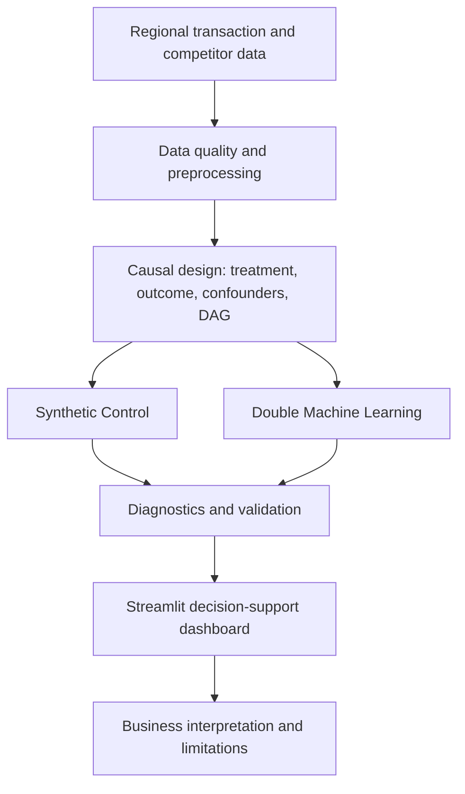
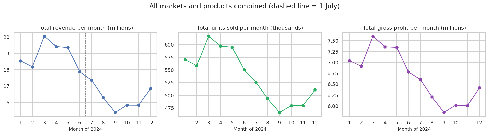
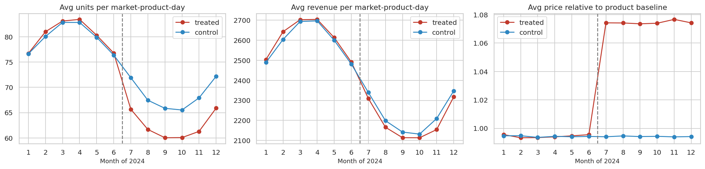
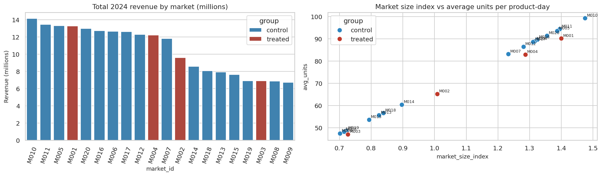
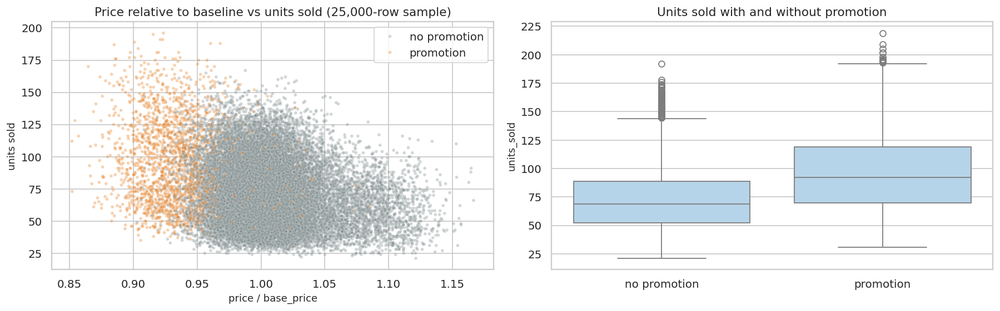
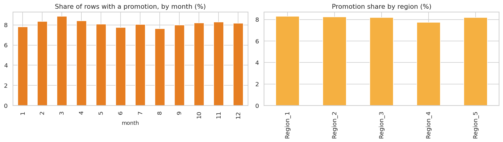
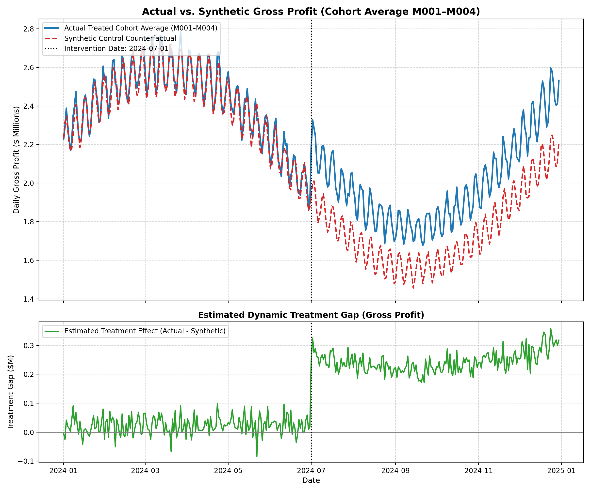
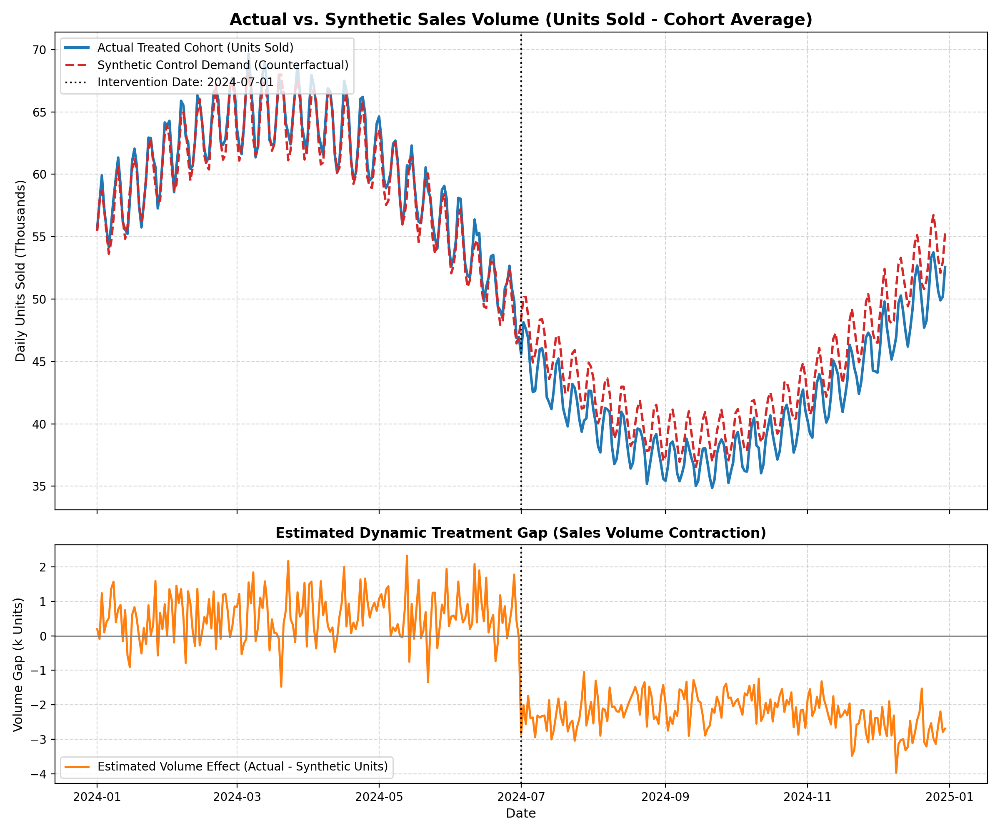
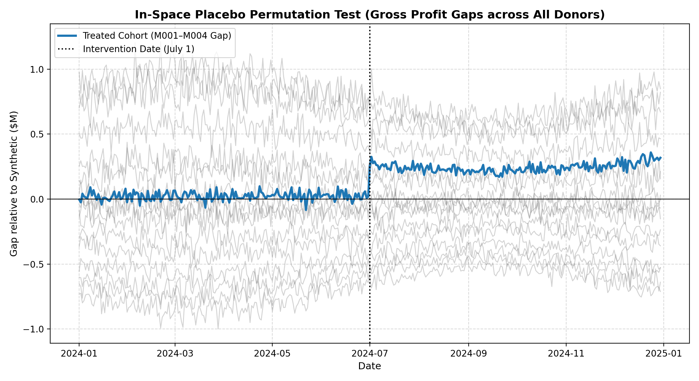

# Causal Inference & Synthetic Control Engine for Algorithmic Pricing

> **Zaalima Development | Data Analytics Internship**  
> **Project status:** Analytical prototype / exploratory validation  
> **Data status:** Simulated development data — not real commercial evidence.

An end-to-end analytical prototype for studying the impact of a pricing intervention using **Synthetic Control**, **Double Machine Learning (DML)**, data-quality diagnostics, and an interactive **Streamlit** dashboard.

> [!WARNING]
> The supplied development dataset is simulated. DML outputs are explicitly labelled exploratory and not validated causal findings. Do not present these estimates as real-world business impact. Confirm dataset approval and causal assumptions with the project mentor before final submission.

## Contents

- [Project overview](#project-overview)
- [Business problem](#business-problem)
- [Objectives](#objectives)
- [Dataset overview](#dataset-overview)
- [Analytical workflow](#analytical-workflow)
- [Methodology](#methodology)
- [Dashboard preview and visualizations](#dashboard-preview-and-visualizations)
- [Repository structure](#repository-structure)
- [Technology stack](#technology-stack)
- [Installation and execution](#installation-and-execution)
- [Validation and testing](#validation-and-testing)
- [Current findings and interpretation](#current-findings-and-interpretation)
- [Limitations and risks](#limitations-and-risks)
- [Team responsibilities](#team-responsibilities)
- [Future improvements](#future-improvements)

## Project overview

The project investigates how to estimate the effect of a dynamic pricing intervention on business outcomes such as revenue, gross profit, and units sold. It combines a market-product-date panel, exploratory data analysis, Synthetic Control diagnostics, a DML-style estimation pipeline, and a Streamlit dashboard.

**Central question:** What might have happened to the treated markets if the pricing intervention had not occurred?

The workflow is:



## Business problem

A simple before-and-after comparison cannot establish that a price change caused a change in revenue. Revenue and demand can also be influenced by seasonality, promotions, competitor prices, market characteristics, and other time-varying factors.

This project uses counterfactual methods to construct a comparison for treated markets and estimate treatment effects under explicit assumptions.

## Objectives

- Inspect, clean, and validate market-product-date observations.
- Document the treatment, outcome, comparison group, intervention date, and causal assumptions.
- Explore donor-market selection and Synthetic Control diagnostics.
- Implement a reusable DML-style pipeline with preprocessing and cross-fitting.
- Check input validity, missingness, overlap, leakage risks, and estimate stability.
- Present descriptive analysis and saved model diagnostics in Streamlit.
- Communicate assumptions, uncertainty, limitations, and reproducibility requirements.

## Dataset overview

The supplied development data documents a simulated panel with:

| Attribute | Documented value |
|---|---:|
| Observations | 87,600 rows |
| Markets | 20 |
| Products | 12 |
| Date range | 2024-01-01 to 2024-12-30 |
| Treated markets | M001, M002, M003, M004 |
| Intervention date | 2024-07-01 |
| Simulated price intervention | 8% increase in treated markets |

The final calendar day of leap year 2024 (December 31) is absent from the documented data range. Currency and measurement units are not specified in the supplied dataset and should not be inferred.

### Main fields

| Field | Description |
|---|---|
| `market_id` | Market identifier |
| `region` | Region metadata |
| `product_id` | Product identifier |
| `category` | Product category |
| `date` | Observation date |
| `treated_market` | Indicator for designated treated markets |
| `treatment_date` | Configured intervention date |
| `treatment` | Treatment-period indicator |
| `price` | Selling price |
| `competitor_price` | Competitor price feature |
| `promotion` | Promotion feature |
| `seasonal_index` | Simulated seasonal feature |
| `units_sold` | Units sold outcome |
| `revenue` | Revenue outcome |
| `unit_cost` | Unit cost feature |
| `gross_profit` | Gross profit outcome |

## Analytical workflow

1. **Business understanding:** define the pricing question and business outcomes.
2. **Data preparation:** inspect schema, dates, duplicates, missingness, and data types.
3. **Causal design:** specify treatment, outcome, pre-treatment period, confounders, and assumptions.
4. **Exploratory analysis:** study time trends, market/product variation, pricing, promotions, and demand.
5. **Synthetic Control:** construct weighted donor-market comparisons and inspect pre-treatment fit.
6. **DML:** preprocess covariates, fit nuisance models, use date-block cross-fitting, and estimate exploratory effects.
7. **Validation:** inspect overlap, leakage, missing-data behaviour, output shape, and estimate stability.
8. **Dashboard and reporting:** show descriptive views and saved diagnostic artifacts with clear caveats.

## Methodology

### Synthetic Control

Synthetic Control constructs a weighted combination of donor markets to approximate the treated market's pre-intervention outcome trajectory. The post-intervention gap between actual and synthetic outcomes is examined as a counterfactual diagnostic.

The implementation includes donor weights, actual-versus-synthetic plots, pre/post MSPE diagnostics, and placebo-related artifacts. Poor pre-treatment fit must be disclosed rather than hidden. MSPE ratios are diagnostics, not p-values or proof of causality.

### Double Machine Learning

The current DML pipeline includes:

- Input and schema checks.
- Numeric and categorical preprocessing.
- Ridge outcome nuisance model and Logistic Regression treatment nuisance model.
- Date-block cross-fitting using `GroupKFold`.
- Partialling-out treatment-effect estimation.
- Propensity overlap screening and diagnostic outputs.

The saved estimates are marked `EXPLORATORY_NOT_VALIDATED`. The current IID-only standard-error approach is not suitable as final inference for repeated market/product/time observations. The treatment assignment, confounder set, time structure, possible spillovers, and panel dependence require further review.

### ATE and CATE

The official project plan calls for ATE and CATE analysis. The supplied exploratory DML output contains point estimates by outcome; that alone does **not** demonstrate a validated CATE analysis. Do not mark CATE complete until subgroup/conditional estimates and their validation are implemented and documented.

## Dashboard preview and visualizations

The repository contains the following genuine analytical figures. These are embedded graph assets from the project files, **not screenshots of a live hosted Streamlit session**. The Streamlit application itself contains six interactive tabs described below.

### Streamlit dashboard sections

| Tab | What it presents |
|---|---|
| Overview | Filtered KPIs, outcome trends, outcome mix, price-demand relationship |
| Market & Product | Market performance, product/category comparison, searchable market summary, CSV export |
| Pricing & Promotions | Selling price versus competitor price, promotion comparison, price distributions |
| Synthetic Control | MSPE diagnostics, actual-versus-synthetic charts, donor weights and download |
| DML Diagnostics | Saved exploratory DML estimates and diagnostic warnings |
| Data Quality | Missingness profile, validation checks, filtered record explorer, CSV downloads |

Sidebar controls include date range, markets, products, categories, metric, daily/weekly/monthly granularity, and reset filters. The app's descriptive views respond to the selected filters. Saved SCM/DML artifacts are displayed as precomputed outputs; changing dashboard filters does not rerun the causal estimators.

### EDA and descriptive visualizations

**Monthly totals**



**Treated versus control markets**



**Units sold and seasonality**


**Market comparison**



**Product comparison**


**Price versus units sold**



**Competitor price gap**


**Promotion analysis**



**Distributions**


**Units sold boxplot**


### Causal diagnostics visualizations

**Actual versus synthetic gross profit**



**Actual versus synthetic units sold**



**Placebo-in-space distribution**



## Repository structure

The supplied Git repository places the application and supporting files inside the `data preparation/` directory:

```text
Zaalima-Development-Data-Analytics-Internship/
└── data preparation/
    ├── app/
    │   └── streamlit_app.py
    ├── data/
    │   ├── raw/
    │   ├── processed/
    │   ├── cleaned_regional_market_transactions.csv
    │   ├── dml_estimates_exploratory.csv
    │   ├── dml_diagnostics.json
    │   └── scm_diagnostics_mspe.csv
    ├── docs/
    │   ├── figures/
    │   ├── business_question.md
    │   ├── causal_design.md
    │   ├── data dictionary.md
    │   ├── data quality report.md
    │   ├── dml_methodology.md
    │   ├── synthetic_control.md
    │   └── validation_diagnostics.md
    ├── notebooks/
    │   ├── 01 eda.ipynb
    │   └── 02_dml_analysis.ipynb
    ├── reports/
    │   ├── dml_run/
    │   ├── validation results.csv
    │   └── dq issue log.csv
    ├── src/
    │   ├── clean pricing data.py
    │   ├── dashboard_utils.py
    │   ├── dml_diagnostics.py
    │   ├── dml_pipeline.py
    │   └── run_synthetic_control.py
    ├── tests/
    │   ├── test_dashboard_utils.py
    │   └── test_dml_pipeline.py
    ├── requirements.txt
    └── README.md
```

## Technology stack

- **Language:** Python
- **Data analysis:** Pandas, NumPy
- **Machine learning:** Scikit-learn
- **Causal methods:** Synthetic Control and DML-style partialling-out workflow
- **Optimization/statistics:** SciPy (used by the Synthetic Control implementation)
- **Dashboard:** Streamlit
- **Interactive charts:** Plotly
- **Visualization/notebooks:** Matplotlib, Seaborn, Jupyter
- **Version control:** Git and GitHub

## Installation and execution

Run commands from the `data preparation/` directory.

### 1. Create and activate a virtual environment

**Windows PowerShell**

```powershell
python -m venv .venv
.venv\Scripts\Activate.ps1
```

**macOS/Linux**

```bash
python -m venv .venv
source .venv/bin/activate
```

### 2. Install runtime dependencies

The checked-in `requirements.txt` should be reviewed and updated because the Streamlit app imports Streamlit and Plotly, the DML pipeline imports scikit-learn, and the Synthetic Control code imports SciPy. Install the required packages in the environment:

```bash
python -m pip install --upgrade pip
python -m pip install pandas numpy scikit-learn scipy streamlit plotly matplotlib seaborn jupyter
```

For reproducible team setup, pin and record the tested versions in `requirements.txt` after verifying the environment.

### 3. Run the Streamlit dashboard

```bash
streamlit run app/streamlit_app.py
```

Keep the cleaned transaction CSV at:

```text
data/cleaned_regional_market_transactions.csv
```

### 4. Run tests

```bash
python -m pytest -q
```

Record the actual command output and environment. Do not report tests as passed unless they were run successfully on the current revision.

## Validation and testing

The project contains data validation reports, DML diagnostic artifacts, and unit-test files. Validation should cover:

- Required columns and valid data types.
- Duplicate market-product-date keys.
- Missing and invalid dates.
- Binary treatment coding and treatment timing.
- Preprocessing behaviour and missing-data handling.
- Date-block cross-fitting and leakage prevention.
- Propensity overlap/positivity.
- Model output shape and missing values.
- Synthetic Control donor weights and pre-treatment fit.
- Reproducibility and dashboard data loading.

A prior repository review recorded 10 unit tests passing in its audit environment. This is not a fresh test result for every later repository revision, not an end-to-end browser test, and not evidence of causal validity. Re-run the tests before making a current claim.

## Current findings and interpretation

The saved exploratory DML report lists these point estimates:

| Outcome | Exploratory estimate | Status |
|---|---:|---|
| Gross profit | -19.0018 | `EXPLORATORY_NOT_VALIDATED` |
| Revenue | -45.7928 | `EXPLORATORY_NOT_VALIDATED` |
| Units sold | -3.44654 | `EXPLORATORY_NOT_VALIDATED` |

These values are from simulated development data. They are not validated causal effects, and the IID-only standard errors must not be presented as final panel-robust confidence intervals.

The saved Synthetic Control MSPE diagnostics should be interpreted market by market. A poor pre-treatment fit or unusually large post/pre MSPE ratio requires investigation and transparent reporting; it does not establish statistical significance by itself.

## Limitations and risks

- The supplied transaction panel is simulated, not real commercial data.
- Currency and measurement units are not specified.
- The documented date range omits 2024-12-31.
- Treatment is configured for four markets from 2024-07-01; causal identification and confounding assumptions need review.
- Market, product, and time dependence mean IID-only uncertainty estimates are not adequate for final inference.
- Possible spillovers between markets may violate standard comparison assumptions.
- CATE completion is not established by the saved point-estimate table.
- The dashboard displays saved SCM/DML artifacts; its filters do not refit the causal models.
- A fully dynamic what-if pricing simulator is not established by the inspected app code.
- No public hosted dashboard URL was present in the reviewed repository package. Do not claim public deployment without a working URL and verification.
- The current `requirements.txt` does not list all runtime imports used by the app and modelling modules; update it after environment verification.

## Team responsibilities

The supplied proposed work distribution assigns the following ownership:

| Member | Main responsibility | Handover |
|---|---|---|
| Fatima | Data sourcing, data quality, cleaning, and basic EDA | Documented, analysis-ready data |
| Shrusti | Causal design and Synthetic Control | Treatment design, synthetic baseline, diagnostics |
| Aniket | Double Machine Learning, validation, and integration | DML outputs, tests, model interfaces |
| Harish | Testing, dashboard support, and final documentation | Test evidence, user guide, report support |

This is a proposed team allocation. Follow the latest mentor instructions if they differ. Describe individual contributions accurately and commit only genuine work under the correct Git identity.

## Future improvements

1. Obtain mentor approval for the dataset or replace it with an approved real dataset.
2. Review the DAG, treatment assignment, confounder set, time structure, and spillover assumptions.
3. Assess donor-pool quality and investigate poor Synthetic Control pre-treatment fit.
4. Strengthen panel-aware inference and uncertainty estimation for DML.
5. Implement and validate CATE/subgroup analysis if required by the final scope.
6. Add a genuine counterfactual what-if interface that reruns the relevant calculations and clearly reports assumptions.
7. Add integration and end-to-end tests, pin dependencies, and document reproducible setup.
8. Deploy only after validation, access controls, and mentor approval; then add the verified application URL here.

## Disclaimer

This repository is an internship development prototype. Its outputs are intended for learning, software development, and analytical demonstration. They must not be used as commercial pricing recommendations or represented as proven causal effects without approved data, validated identification assumptions, appropriate statistical inference, and documented review.
