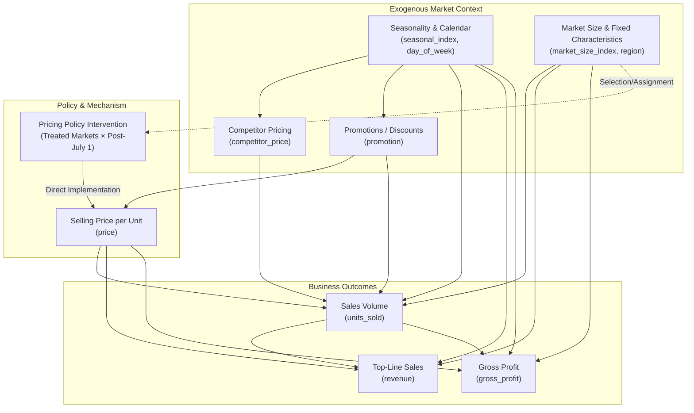

# Task 2: Causal Design, Confounders, and Hypothesized DAG

## 1. Confounders & System Variables

To determine the causal effect of the algorithmic price policy on gross profit, revenue, and units sold, we must isolate the intervention from confounding factors that independently drive customer purchasing behavior:

| Variable | Structural Role | Economic Mechanism & Analytical Strategy |
| :--- | :--- | :--- |
| **`promotion`** | **Observed Confounder** | Promotional campaigns cut unit prices (~7% discount) while driving substantial sales spikes (+34% units). Promotions must be controlled for or balanced across markets to avoid attributing promotional spikes to the pricing policy. *(30 missing values present in dataset; must be explicitly treated/flagged).* |
| **`competitor_price`** | **Observed Confounder** | Competitor pricing shifts local consumer demand elasticity and cross-price substitution. *(60 missing values present in dataset).* |
| **`seasonal_index` / `day_of_week`** | **Exogenous Demand Driver** | Systemic demand waves influence customer volume across all markets (e.g., annual peak in March at ~20.1M, annual low in September at ~15.4M). Modeled via time fixed effects ($\lambda_t$). |
| **`market_size_index` / Region** | **Time-Invariant Confounder** | Markets vary inherently in scale (e.g., treated market M003 has size index 0.73, whereas M001 has size index 1.40). Modeled via unit fixed effects ($\gamma_m$). |
| **`price`** | **Mediator / Direct Mechanism** | **Do NOT condition on selling price directly** when estimating the overall causal impact of the pricing policy. Price is the causal channel through which the policy transmits its effect; controlling for price blocks the effect and induces post-treatment bias. |
| **Outcome Variables (`gross_profit`, `revenue`, `units_sold`)** | **Outcomes (Avoid Leakage)** | When modeling one outcome (e.g., `units_sold`), other outcomes (`revenue`, `gross_profit`) must not be used as predictive features due to tautological outcome leakage. |

---

## 2. Hypothesized Causal Directed Acyclic Graph (DAG)

---

## 3. Causal Identification Assumptions & Threats

### A. Parallel Counterfactual Trends
* **Core Assumption:** In the absence of the July 1 intervention, treated markets (M001–M004) would have followed the same average trajectory in gross profit, revenue, and units sold as the selected donor markets.
* **Pre-Intervention Evidence:** Exploratory analysis indicates the monthly ratio of average units sold between treated and control markets stayed steady between 1.00 and 1.01 from January to June.
* **Threat & Verification:** While reassuring, historical pre-trend similarity is not a mathematical guarantee of parallel post-period paths. Event-study specifications and placebo lead tests ($t - 4, t - 3, \dots, t - 1$) must confirm lead coefficients are statistically indistinguishable from zero.

### B. Stable Unit Treatment Value Assumption (SUTVA) & Spillovers
* **Core Assumption:** The treatment of markets M001–M004 does not affect sales or pricing behavior in control markets (no cross-market interference).
* **Threat:** If customers in treated markets travel or substitute online orders toward neighboring untreated markets due to the +8% price hike, control market sales are artificially inflated. This would bias the estimated treatment effect downward for volume and distort profit estimates.

### C. Absence of Concurrent Shocks
* **Core Assumption:** No unobserved, market-specific events (e.g., targeted regional supply chain disruptions, regional marketing pushes, or manager turnover) coincided with the July 1 launch exclusively in M001–M004.

---

## 4. Alternative Explanations & Limitations

1. **DAG as Hypothesized Structure, Not Proof:**  
   The DAG visualizes structural causal hypotheses based on economic reasoning and domain knowledge. It does not prove that unobserved confounding is absent.
2. **Missing Confounder Data:**  
   The dataset contains 60 missing values in `competitor_price` and 30 missing values in `promotion`. Missingness must not be blindly imputed as zeroes or omitted without sensitivity checks.
3. **Simultaneous Single-Cohort Rollout:**  
   All four treated markets received the intervention on the identical date (July 1, 2024). Staggered rollout designs cannot be leveraged, heightening vulnerability to calendar-specific shocks.
4. **Data Simulation Nature:**  
   As noted in project specifications, this dataset is simulated. Findings represent demonstration of causal estimation methods rather than real commercial behavior.

feat: identify potential confounding variables
